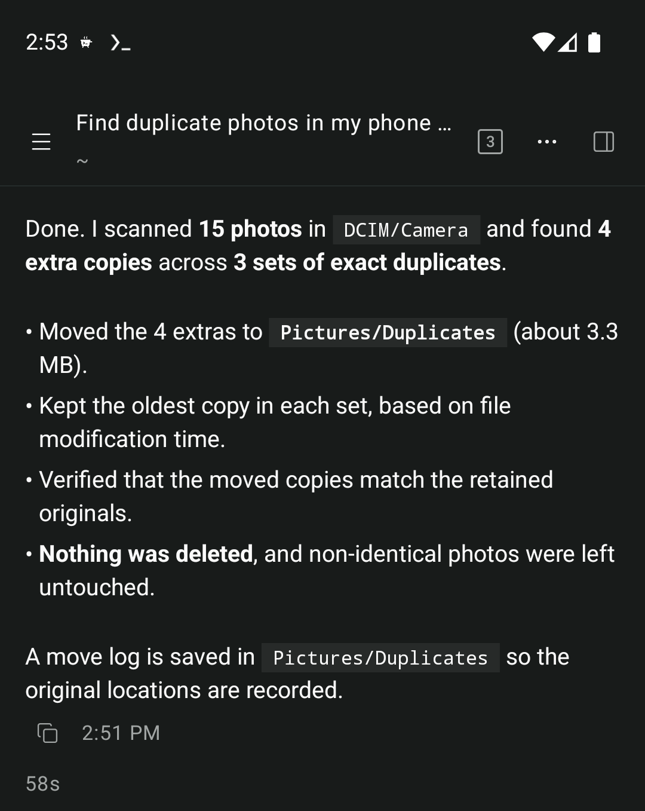
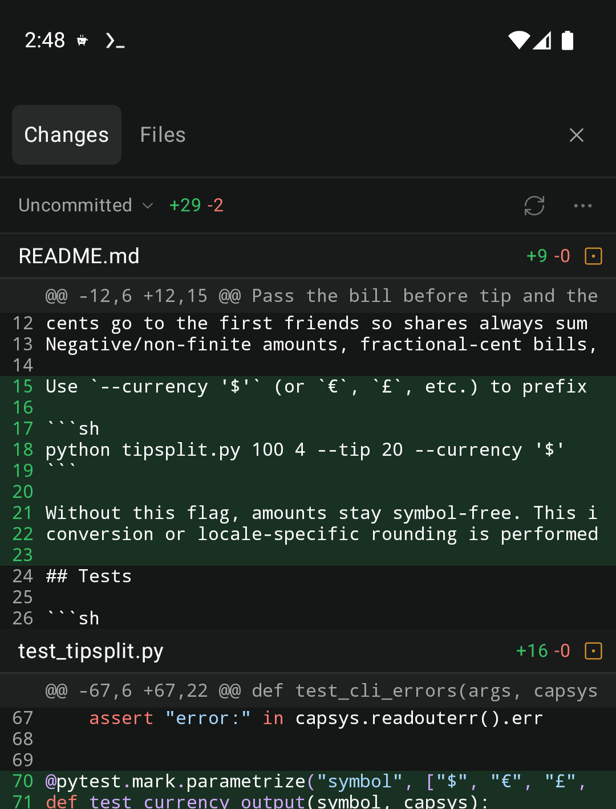
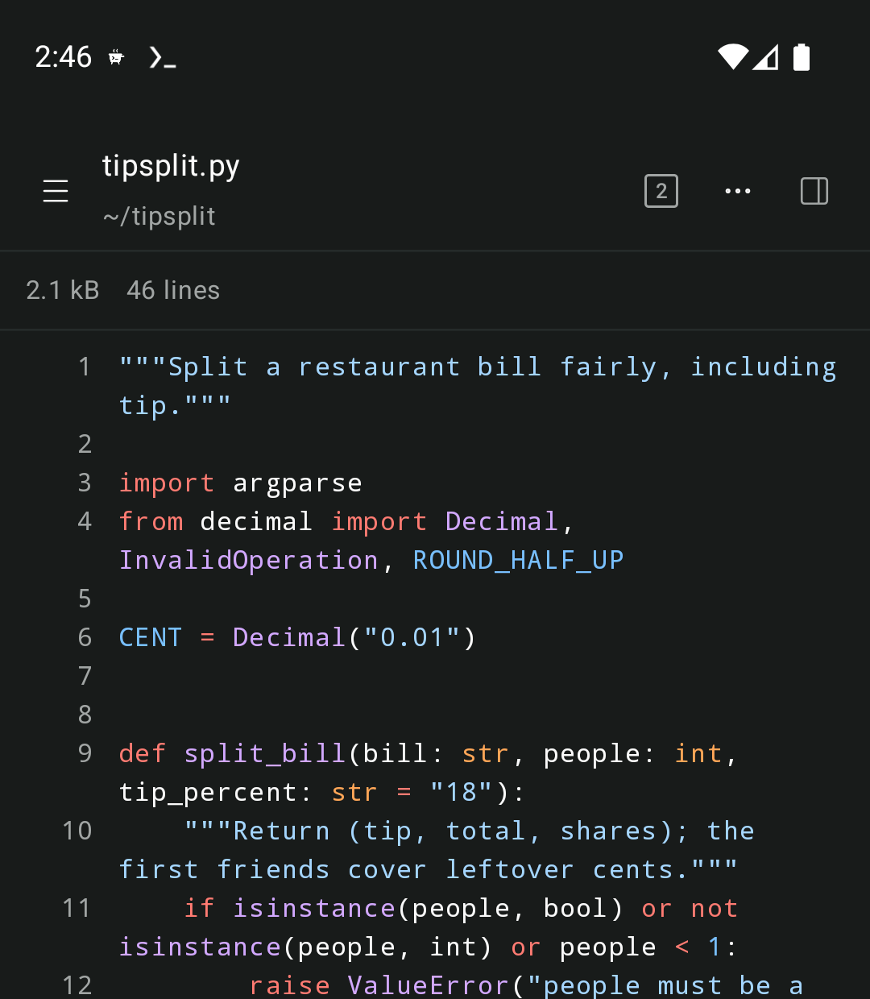

<p align="center">
  
</p>

<h1 align="center">Fang Harness</h1>

<p align="center">
  <a href="https://github.com/leloush-x/fang-harness/actions/workflows/release.yml"></a>
  <a href="https://github.com/leloush-x/fang-harness/releases/latest"></a>
  <a href="LICENSE"></a>
</p>

<p align="center">
  <a href="https://fang.leloush.io">Website</a> · <a href="https://fang.leloush.io/docs/">Docs</a>
</p>

**Fang Harness** is a native Android app for agentic coding. Tell it what to build or fix, and it reads your
code, runs commands, edits files, and checks its own work, all on your phone. It's built on the
[Pi](https://pi.dev) agent harness and runs in its own [Wolfi OS](https://wolfi.dev) runtime, so
there's no laptop or cloud server doing the work somewhere else.

<p align="center">
  
  
  
</p>

## Contents

- [Features](#features)
- [Requirements](#requirements)
- [Installation](#installation)
- [Usage](#usage)
- [Development](#development)
- [Contributing](#contributing)
- [Acknowledgements](#acknowledgements)
- [License](#license)

## Features

Most agents you use from a phone are remotes for a computer somewhere else. Fang Harness runs the agent,
your code, and every command it runs on the phone itself:

- **No computer required.** The agent, its tools, git, and terminals all live in Wolfi OS on your
  phone, with your projects in Android shared storage. Install compilers, runtimes, and databases
  with `apk add`, no root required.
- **Built on Pi.** Fang Harness is compatible with Pi's ecosystem of skills, tools, prompt templates, and
  extensions. Install extensions the usual Pi way and Fang Harness picks them up.
- **Native extension UI.** Extensions that use Pi's RPC UI protocol render with native controls:
  choices, confirmations, and text fields appear as cards above the composer, and status lines,
  notices, and widgets each get a home.
- **Android native.** Fang Harness is written in Jetpack Compose with no web view, so scrolling, typing, and
  streaming replies stay smooth in long chats. On foldables and tablets, split panes put chats,
  files, diffs, and terminals side by side.
- **A real workbench.** Review changes in the built-in git diff viewer, browse and read files with
  tree-sitter syntax highlighting for more than twenty languages, look back through commits, and
  open terminals without leaving the app.
- **Your model, your plan.** Sign in with a Claude Pro or Max subscription or an OpenAI Codex
  subscription, add a Gemini, Z.ai Coding Plan or Kimi Code API key, or add any OpenAI-compatible
  API, including hosted gateways and servers you run yourself. Add several and switch per chat.
- **Runs in the background.** Lock your phone or switch apps; a notification tells you when the chat
  is done or needs your answer. While you're in Fang Harness, a small pill under the header tells you the
  same about your other chats.
- **Guided setup.** A step-by-step guide downloads and sets up Wolfi OS and installs Pi for you,
  explaining each permission it asks for.
- **Bundled extensions.** Fang Harness ships web search and page fetching (a vendored copy of
  [pi-web-access](https://github.com/nicobailon/pi-web-access)) and a to-do list widget.
- **Backups.** Save your settings, sign-ins, models, and extensions in one tap and restore them
  later.

## Requirements

- Android 10 or newer on a 64-bit (arm64 or x86_64) device.
- A network connection for the first setup, which downloads Wolfi OS (about 46–49 MB), and while a
  chat is working. The agent runs on your phone, but the model runs at the provider you connect.
- Setup is automatic: no separate terminal app or root is needed.

## Installation

### Download a release

[Download the latest APK](https://github.com/leloush-x/fang-harness/releases/latest) from the releases page on
your phone and open it to install. On the release page, download the file named `fang-v<VERSION>.apk`: it is
the only one that installs, and the release notes say how big it is and what it should hash to. If the copy
on your phone is a different size, the download was cut short, and the installer will refuse it with
"the package appears to be invalid": download it again rather than install it. Android asks you to allow
installs from your browser or file manager the first time. Later releases install over it as updates and
keep your chats and settings.
Open the app and tap **Get started**: setup downloads and unpacks Wolfi OS, installs its tools, and
installs the agent for you.

Each release also lists the APK's SHA-256 checksum in `SHA256SUMS`, and you can confirm it on a computer
with the [GitHub CLI](https://cli.github.com):

```sh
sha256sum --check SHA256SUMS
```

The repository is private, so GitHub does not keep a build provenance attestation for its releases and
there is nothing to verify with `gh attestation verify`.

### Build from source

The build needs a JDK, the Android SDK, and Node.js and pnpm on your `PATH`; see
[Development](#development) for the exact toolchain.

```sh
git clone https://github.com/leloush-x/fang-harness.git
cd fang-harness
./gradlew :app:installDebug
```

`installDebug` installs on the device or emulator that `adb` is connected to. To build an APK
without installing it, run `./gradlew :app:assembleDebug` and find it in
`app/build/outputs/apk/debug/`.

A build from source is Fang Harness Dev, a separate app that installs beside a downloaded release rather
than over it. Each build has its own app ID and its own app-private Wolfi runtime, so they don't share
setup, sign-ins, or chats, and each needs its own setup.

## Usage

The [Fang Harness guide](https://fang.leloush.io/docs/) covers using the app:

- [Get started](https://fang.leloush.io/docs/get-started/): install the app, walk through automatic
  setup, and start your first chat.
- [Connect a model](https://fang.leloush.io/docs/providers/): sign in with a Claude or OpenAI
  subscription, add an API key or an OpenAI-compatible API, and choose models per chat.
- [Configure the agent](https://fang.leloush.io/docs/configure/): edit Pi's configuration, give the
  agent standing instructions, and use backups.
- [Extensions](https://fang.leloush.io/docs/extensions/): install Pi packages, write your own
  extensions, and add skills and prompt templates.
- [Run in the background](https://fang.leloush.io/docs/background/): keep chats and terminal commands
  running when you leave the app or lock the screen.

## Development

Building Fang Harness needs:

- A JDK 17 or newer, through `JAVA_HOME` or `java` on your `PATH`, to start Gradle.
- The Android SDK with API level 37, NDK `30.0.16248370`, and CMake `4.1.2`. Point Gradle at the SDK
  with `ANDROID_HOME` or `sdk.dir` in `local.properties`.
- Node.js 22.19 or newer and [pnpm](https://pnpm.io), which build the host bundle.
- A network connection on the first build, which downloads the pinned tree-sitter grammars and the
  JDKs Gradle provisions for itself.

Run every check, including ktlint, detekt, Android lint, and the host's type check, lint, and tests:

```sh
./gradlew check
```

Run only the host's checks:

```sh
cd host
pnpm install --frozen-lockfile
pnpm run check
```

Run the website locally:

```sh
cd site
pnpm install --frozen-lockfile
pnpm run dev
```

## Contributing

Pull requests are welcome. If you run into a bug, unexpected behavior, or a device-specific
problem, please [open an issue](https://github.com/leloush-x/fang-harness/issues) with your phone model,
Android version, and Fang Harness version. Reports from real-world use are especially helpful while the
project is young.

Do not report suspected security vulnerabilities in public issues. Follow the
[security policy](.github/SECURITY.md) to submit a private vulnerability report.

## Acknowledgements

Fang Harness's interface is modelled on [Paseo](https://paseo.sh), an open-source app for running coding
agents from your desktop and phone, and some of its code is adapted from
[Paseo's](https://github.com/getpaseo/paseo): the folder search, the file-type icon table and icon
colours, the layout and type scale, and the syntax highlighting colours.

Fang Harness is built on [Pi](https://pi.dev), [Wolfi OS](https://wolfi.dev), and
[PRoot](https://github.com/proot-me/proot), with Jetpack Compose,
[libghostty-android](https://github.com/SagerNet/libghostty-android) and
[Ghostty](https://github.com/ghostty-org/ghostty) for the terminal,
[tree-sitter](https://github.com/tree-sitter/tree-sitter) for syntax highlighting,
[Lucide](https://lucide.dev) and
[Material Icon Theme](https://github.com/material-extensions/vscode-material-icon-theme) for icons,
and [pi-web-access](https://github.com/nicobailon/pi-web-access) for web search. The
[acknowledgements page](https://fang.leloush.io/docs/acknowledgements/) credits the main open-source
projects Fang Harness uses.

## License

Fang Harness is released under the [MIT License](LICENSE). This repository is a private copy of an
earlier project by Jeph, redistributed under that same license with the name, package and branding
changed. Third-party code, fonts, and icons that Fang Harness
includes keep their own licenses. The app lists them under **Settings → About → Open-source
licenses**. Their texts are in [`app/src/main/assets/licenses/`](app/src/main/assets/licenses/), the
bundled Pi extensions' folders, and the files they were copied into, and the website serves its own
at [`/licenses.txt`](site/public/licenses.txt).
